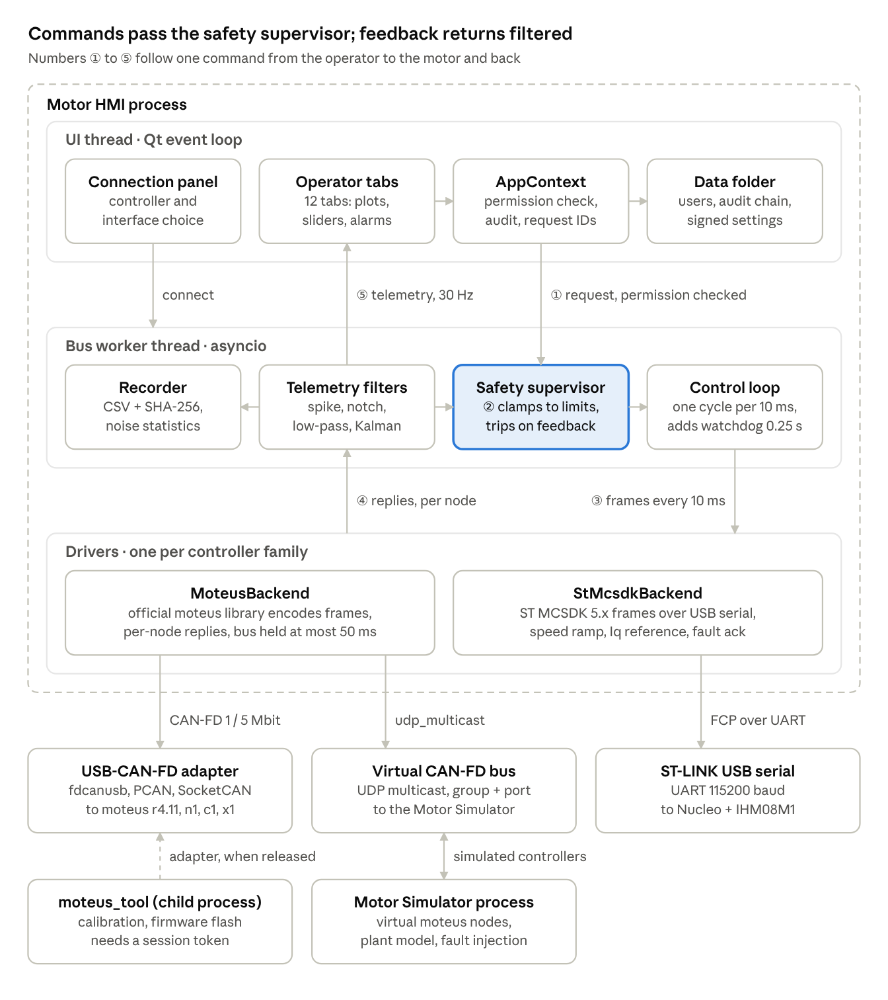
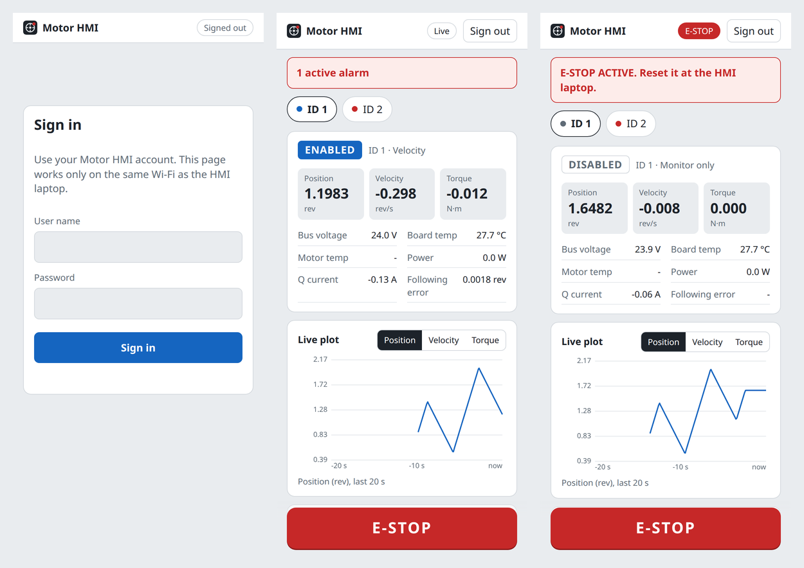

# Motor HMI

A secure operator and engineering HMI for brushless motor controllers, for Windows and
Linux laptops. It controls, calibrates, tunes and monitors **mjbots moteus** controllers
over USB-CAN-FD and **ST X-NUCLEO-IHM08M1** boards over USB serial. A separate **Motor
Simulator** app lets you test everything without hardware.



| Controller (drop-down) | Link | Driver |
|---|---|---|
| mjbots **moteus r4.11**, n1, c1, x1 | USB-CAN-FD: mjbots fdcanusb, SocketCAN, python-can (PCAN, Kvaser, Vector, IXXAT) | official `moteus` Python library |
| **ST X-NUCLEO-IHM08M1** + STM32 Nucleo (MCSDK 5.x) | USB serial (ST-LINK virtual COM port) | MCSDK Motor Control Protocol (FCP) |
| Any STM32 MCSDK 5.x power board | USB serial | same |
| moteus profiles | **Virtual CAN-FD bus** + **Motor Simulator** app | real moteus driver path against simulated controllers |

**Status (v1.0.0):** all 80 automated tests pass, including end-to-end runs against the
Motor Simulator. Not yet validated on real r4.11 / IHM08M1 hardware or on Windows; start
with the motor unloaded and conservative limits.

## Quick start (Linux, from source)

```bash
sudo apt install python3.12-venv libxcb-cursor0
git clone https://github.com/tejavadlamudi03/motor-hmi.git ~/moteus_hmi
cd ~/moteus_hmi
python3.12 -m venv .venv && . .venv/bin/activate
pip install -r requirements.txt
python -m moteus_hmi              # the HMI
python -m moteus_hmi.sim          # the Motor Simulator, in a second terminal
```

In the HMI choose **Interface → Motor Simulator app (virtual CAN-FD bus)** and click
**Connect**. The first start asks you to create the administrator account (there are no
default passwords); write down the **recovery code** it shows.

On a ROS machine, start with `env -u PYTHONPATH python -m moteus_hmi`, so ROS's Python
packages do not load in place of the HMI's.

## Install on another laptop

Follow **[docs/INSTALLATION.md](docs/INSTALLATION.md)** ([Word](docs/INSTALLATION.docx)).
It covers the Linux packaged release (no Python needed, installs read-only to
`/opt/motor-hmi`), Linux from source, Windows 10/11, USB adapter setup, first start, a
verification checklist with the simulator, troubleshooting, updating and uninstalling.

## Mobile view (same Wi-Fi)

A phone on the same Wi-Fi can watch live motor status, plots and alarms, and press **E-STOP**.
An administrator turns it on with **Mobile view** in the HMI's top bar; the phone scans the QR
code, accepts the HMI's own certificate once, and signs in with an HMI account. Enable,
motion and reset stay at the laptop. Details: [User Manual, section 13](docs/USER_MANUAL.md).



## Documentation

Every main document is in Markdown (the source) and Word.

| Document | For |
|---|---|
| [User Manual](docs/USER_MANUAL.md) · [.docx](docs/USER_MANUAL.docx) | operators and commissioning engineers: connect, operate, calibrate, safety, troubleshooting |
| [Installation Guide](docs/INSTALLATION.md) · [.docx](docs/INSTALLATION.docx) | anyone installing on a new laptop |
| [Project Documentation](docs/PROJECT_DOCUMENTATION.md) · [.docx](docs/PROJECT_DOCUMENTATION.docx) | developers, reviewers, safety and security assessors: architecture, protocols, design, tests, release |
| [SIMULATOR](docs/SIMULATOR.md), [HARDWARE](docs/HARDWARE.md), [SAFETY](docs/SAFETY.md), [SECURITY](docs/SECURITY.md), [ADDING_A_CONTROLLER](docs/ADDING_A_CONTROLLER.md) | topic references |

After editing a `.md` file, regenerate the Word versions with
`python packaging/md_to_docx.py` (needs `pip install pypandoc_binary python-docx`).

## What's inside

| Tab | Purpose |
|---|---|
| **Test & Control** | Live position, velocity and torque plots with raw, filtered and setpoint traces. Enable / Save Zero / Disable / Reset fault. Modes: Impedance (MIT-style), Position, Velocity, Torque, Stay-within, Hold/Brake. Each parameter has a slider bounded by the safety limits. Live send with a period in ms, Update / Clear / Send, hold-to-run jog, the live motor dial, status, and raw CAN TX/RX frames. Display units rev / rad / deg. |
| **Bus & Devices** | Discovered controllers (ID, UUID, comm, state, fault, V, °C) and a raw frame monitor (HEX/ASCII). |
| **Parameters** | Read all, filter, edit and apply (RAM), save to flash. Export and import parameter files, which are HMAC-signed, with a reviewed diff before writing. Compatible with `moteus_tool --dump-config` / `--restore-config`. |
| **Calibration** | Full `moteus_tool --calibrate` behind a safety checklist and typed confirmation. ST encoder alignment. Zero / output reference. Controller-side noise reduction (encoder PLL filter, current-loop bandwidth, current slew). Calibration history. |
| **Tuning** | PID gains read / write / save, and a step-response test with rise time, overshoot, settling time and steady-state error. |
| **Feedback & Filters** | HMI-side noise reduction per signal: spike rejection (median / Hampel), notch, then smoothing (EMA / Butterworth / Kalman). Live raw-vs-filtered plot, noise σ and dB reduction table, and CSV recording with a SHA-256 sidecar. |
| **Safety & Alarms** | Per-motor limits (speed, acceleration, torque, soft position limits, voltage, temperature, following error). E-stop action, loop rate, controller watchdog, comm-loss trip. Push limits into the controller's flash. Alarm journal with acknowledge and CSV export. |
| **Parse** | Decode moteus CAN-FD register frames and ST FCP frames. View recordings with checksum verification. |
| **Firmware** | Read the firmware version. moteus firmware upgrade via `moteus_tool --flash`, allowed only for images whose SHA-256 an administrator approved. |
| **Console** | Allow-listed diagnostic console (`conf get/set/enumerate/write`, `tel list`) and telemetry channel reader. Motion commands are refused here. |
| **Users & Audit** | User and role management (Viewer, Operator, Engineer, Admin), auto-lock timeout, tamper-evident audit trail (view, verify, export). |
| **About** | Versions, data folder, supported controllers, safety notice, licences. |

## Tests

80 tests, all without hardware, including HMI to simulator over a virtual CAN-FD bus:

```bash
PYTEST_DISABLE_PLUGIN_AUTOLOAD=1 QT_QPA_PLATFORM=offscreen python -m pytest -q tests
```

Install `pytest` first (`pip install pytest`). On a ROS machine, prefix `env -u PYTHONPATH`.

## Build the installers

| OS | Command | Output |
|---|---|---|
| Linux | `bash packaging/build_linux.sh` | `dist/MotorHMI-<ver>-linux-x86_64.tar.gz` + `.sha256`; install with `sudo ./install.sh` |
| Windows | `powershell -ExecutionPolicy Bypass -File packaging\build_windows.ps1` | `dist\MotorHMI-<ver>-win64.zip`, plus a `setup.exe` if Inno Setup 6 is installed |

Each build script runs the test suite first and refuses to package a failing build, and
writes SHA-256 checksums of every file. A Linux build runs on the same or a newer glibc
than the build PC (built on Ubuntu 24.04: needs Ubuntu 24.04+, Debian 13+, Fedora 39+).
Sign the Windows executable with your code-signing certificate before release.

## Layout

```
moteus_hmi/
  core/        bus worker (control loop), backends, safety supervisor, filters, calibration tools
  security/    key store, users/roles, audit trail
  sim/         Motor Simulator: virtual moteus nodes on CAN-FD + window
  ui/          main window, connection panel, tabs/, widgets, theme
tests/         unit + integration tests (simulator, fake MCSDK port, real moteus encoder)
packaging/     PyInstaller spec, Linux / Windows build + install scripts, udev rules, docx converter
docs/          manuals (.md + .docx), topic references, architecture diagram
```

## Safety

This software adds supervision on top of the controller's own protections. It is **not**
a safety-rated emergency stop: wire a hardware E-stop that removes motor power. See
[docs/SAFETY.md](docs/SAFETY.md).

## License

Proprietary. Third-party components keep their own licences: the moteus Python library
(Apache-2.0, mjbots Robotic Systems) and Qt / PySide6 (LGPLv3).
