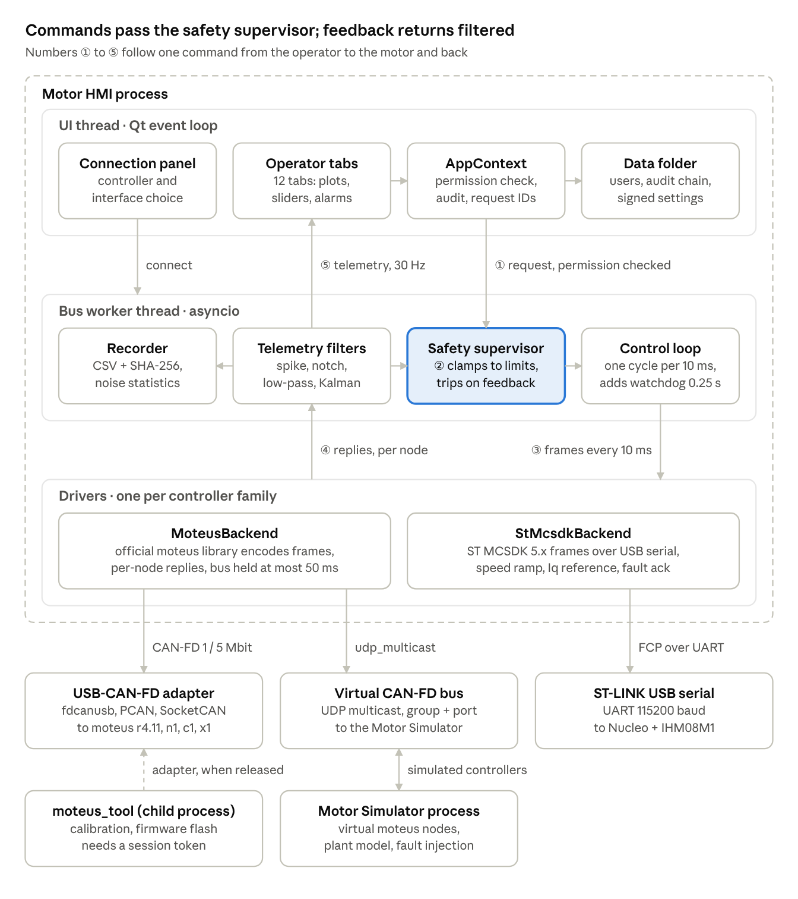

# Motor HMI Project Documentation

Nov 9, 2026 · Meena Salika

Motor HMI 1.0.0 is a Python/PySide6 HMI for moteus and ST MCSDK motor controllers, with a separate Motor Simulator. This document describes how it is built, why, and how it is verified. It is for developers, reviewers and safety or security assessors; operators use the [User Manual](USER_MANUAL.md).

| Item | Value |
| --- | --- |
| Version | 1.0.0 |
| Source code | `~/moteus_hmi` (about 11,500 lines) |
| Stack | Python 3.12, PySide6 6.12, pyqtgraph 0.14, moteus 1.1.3, python-can 4.6 |
| Verification | 80 automated tests, all passing; end-to-end runs against the Motor Simulator |
| Not yet validated | real moteus r4.11 and X-NUCLEO-IHM08M1 hardware; a Windows build |

## 1. Architecture

Motor HMI is one process with two threads: a UI thread that never touches the bus, and a bus worker thread that owns the control loop. Every command passes the worker's safety supervisor before a driver turns it into frames, and every reply comes back through the filters and the supervisor before the operator sees it. Calibration, flashing and simulation run as separate processes.



**How one command flows** (numbers match the diagram)

1. **① Request.** The operator presses Send in a tab. AppContext checks the role's permission and writes an audit entry. It then hands the request to the bus worker by a thread-safe call.
2. **② Clamp.** The safety supervisor limits speed, acceleration, torque, soft position and board voltage. It refuses the command if the motor is disabled, tripped or the E-stop is latched.
3. **③ Send.** Every 10 ms the control loop picks one command per motor (E-stop, then trip, then disabled, then operator). It adds the 0.25 s controller watchdog, and the driver encodes and sends the frames.
4. **④ Reply.** Replies are collected per node. A silent node loses only its own reply; after 10 misses it trips on comm loss while the other motors keep running.
5. **⑤ Feedback.** The filters remove spikes and noise, the supervisor checks trips, and the recorder writes the samples. Every 33 ms a batch reaches the UI as a Qt signal for plots, the motor dial and alarms.

**Components**

| Component | Runs in | Responsibility | Code |
| --- | --- | --- | --- |
| Operator tabs | UI thread | 12 screens: plots, sliders, parameters, alarms | `ui/tabs/` |
| Connection panel | UI thread | controller and interface choice, connect / disconnect | `ui/connection_panel.py` |
| AppContext | UI thread | permission check per action, audit entry, request routing to the worker | `ui/context.py` |
| Data folder | disk | users (HMAC), audit hash chain, signed settings and limits, recordings, calibration reports | `security/`, `settings.py` |
| Safety supervisor | bus worker | command clamping, trip evaluation, E-stop latch | `core/safety.py` |
| Control loop | bus worker | 100 Hz cycle (20 Hz for ST), command priority, watchdog | `core/bus_worker.py` |
| Telemetry filters | bus worker | Hampel/median, notch, EMA/Butterworth/Kalman; noise statistics | `core/filters.py`, `core/telemetry.py` |
| Recorder | bus worker | CSV of raw and filtered signals, SHA-256 sidecar | `core/datalog.py` |
| MoteusBackend | bus worker | frames via the moteus library, per-node replies, 50 ms bus lock, diagnostics | `core/moteus_backend.py` |
| StMcsdkBackend | bus worker | ST FCP frames over USB serial | `core/st_mcsdk_backend.py` |
| moteus\_tool | child process | calibration and flashing; the worker releases the adapter meanwhile | `core/tools.py` |
| Motor Simulator | separate process | virtual moteus nodes on the virtual CAN-FD bus | `sim/` |
| Mobile server | own HTTPS threads | phone view on the same Wi-Fi: live state over Server-Sent Events, E-stop, sign-in with HMI accounts | `remote/` |

**Why it is built this way**

- **Separate UI and bus threads:** a slow plot or an open dialog never delays a control cycle. A frozen PC cannot keep motors running, because the controller watchdog stops them.
- **One safety choke point:** every command and every reply passes the supervisor, so no tab can bypass a limit.
- **Drivers behind one interface:** a new controller family needs only a profile and a backend; UI, safety and filters are reused.
- **Official libraries and tools:** frames come from the moteus library and calibration from `moteus_tool`, so the HMI follows upstream firmware changes.
- **Simulator as its own process:** tests use the same driver path as hardware, and the orange banner keeps it from being mistaken for the real machine.
- **Hard-wired E-stop outside the PC:** the only safety-rated layer; it removes motor power independently of everything in the diagram.

## 2. Controller drivers and protocols

Each controller family is a `ControllerProfile` plus a `MotorBackend` driver. The control loop, safety supervisor, filters and UI are shared by all of them.

**Controller registry** (`core/controllers.py`): each profile states its driver, allowed links, supported modes, feature flags, voltage and current rating, and default loop rate. Feature flags gate UI functions:

- `position`, `firmware_watchdog`, `step_test`
- `conf`, `conf_persist`, `channels`, `console`
- `moteus_calibration`, `encoder_align`, `set_output`, `discovery`

**moteus driver** (`core/moteus_backend.py`) uses the official `moteus` library 1.1.3. Frames are encoded with `Controller.make_position`, `make_stop` and the other `make_*` calls, and replies are decoded with the library's register parser.

| Topic | Design |
| --- | --- |
| Telemetry per cycle | mode, position, velocity, torque, Iq, Id, power (F32); motor temperature, voltage, board temperature (INT16); trajectory flag, home state, fault (INT8); control position and velocity (F32) |
| Frame budget | query reply 59 of 64 bytes; every command, query included, ≤ 64 bytes (tested) |
| Commands | always carry `watchdog_timeout`, plus velocity, acceleration and torque limits after clamping |
| Per-node isolation | requests are built per controller and replies collected per request, so a silent node loses only its own reply |
| Bus sharing | control cycles and diagnostic traffic are serialized; one exchange may hold the bus at most 50 ms |
| Diagnostics | text stream (`conf get/set/enumerate/write`, `tel`), plain polling, no flow-control probe; CR/LF/control characters rejected |
| Transports | fdcanusb (serial), python-can (`socketcan`, `pcan`, `kvaser`, `vector`, `ixxat`, `udp_multicast` for the simulator) |

**ST MCSDK 5.x driver** (`core/st_mcsdk_backend.py`) speaks the Frame Communication Protocol over the ST-LINK virtual COM port:

- Frame: `[motor<<5 | code][length][payload][CRC]`, where CRC = low byte + high byte of the 16-bit byte sum. Replies are ACK 0xF0 or NACK 0xFF plus an error code.
- Velocity uses `SET_RAMP` (rpm, duration = Δspeed / acceleration limit). Torque writes the Iq reference, scaled by A/digit and Kt.
- Start, stop and fault acknowledge use `EXECUTE_CMD`. State and fault bits are decoded into text.
- Slow values (voltage, temperature, power) are read every 5th cycle at a 20 Hz loop.
- Tested against `FakeMcsdkPort`, which also reproduces the documented `02 01 1C 1F` example.

**Adding a controller:** add a profile, implement `open / discover / attach / cycle / stop_all / diagnostic / read_channel / set_output / close`, register it in `make_backend()`, and add a protocol-level fake with tests. Good next candidates are Damiao and CubeMars MIT-mode actuators, CANopen CiA 402 drives, and MCSDK 6.x (ASPEP/MCP).

## 3. Safety concept

Motor HMI adds seven protection layers on top of the machine's hard-wired E-stop. None of them is safety-rated (no SIL or PL); the hard-wired E-stop or STO is the only safety function.

| # | Layer | Where | Behaviour |
| --- | --- | --- | --- |
| 1 | Hard-wired E-stop / STO | machine | removes power; the only safety-rated function |
| 2 | Controller watchdog | moteus firmware | every motion command carries `watchdog_timeout` (0.25 s); if commands stop, moteus enters timeout mode by itself. ST MCSDK has none (permanent banner). |
| 3 | Controller limits | moteus flash | `servopos.position_min/max` and `servo.default_timeout_s` pushed from the HMI |
| 4 | Command clamping | HMI | every command clamped to per-motor limits, hard ceilings and the board rating; trajectories always finite |
| 5 | Telemetry supervision | HMI, every cycle | fault, timeout, comm loss, voltage, temperature, over-speed, soft limit, following error |
| 6 | Software E-stop | HMI | latched; torque off or brake; reset needs confirmation, and motors stay disabled |
| 7 | Fail-safe software | HMI | an unhandled exception E-stops all motors; exit and disconnect stop motors; jog is hold-to-run |

**Trip actions**

- Electrical, thermal, fault and comm trips use **STOP** (torque off). A controller already in fault is not sent stop, so its fault code stays visible until acknowledged.
- Motion trips use **HOLD**: a position command at the latched trip position, velocity 0, within the velocity, acceleration and torque limits.

HOLD replaced zero-velocity damping after a simulation showed a 0.3 N·m load driving the axis from 1.05 to 2.13 rev. With HOLD the axis stayed within 0.02 rev.

**Design rules**

- Supervision of speed and temperature uses spike-filtered values, so a single corrupt frame cannot trip the machine. Discrete states (mode, fault) use raw values.
- Trips escalate (HOLD → STOP) but never de-escalate. A new connection starts with cleared trips and disabled motors; a fault that still exists trips again on the first reply.
- Limits are validated on load. Tampered settings are replaced with safe defaults and flagged.

**Residual risks for the machine's risk assessment**

- ST MCSDK boards keep their last setpoint if the link dies.
- Python and Qt are not real-time; jitter is covered by the controller watchdog (≥ 3 loop periods, enforced), and overruns are counted.
- Torque off on a vertical or loaded axis lets the load move; such axes need a mechanical holding brake.
- Mechanical faults are detected only through following error, so set `max_following_error`.

## 4. Security design

Security rests on per-person accounts with roles, MAC-protected files, a hash-chained audit trail and strict input checks. The HMI opens no network ports and makes no outbound connections.

| Control | Implementation |
| --- | --- |
| Accounts | no default accounts; first-run admin plus a one-time 20-character recovery code |
| Passwords | scrypt (N = 2^15, r = 8, p = 1, 16-byte salt); ≥ 10 characters, mixed case, a digit, no user name |
| Brute force | 5 failures lock for 5 min, doubling per repeat; unknown names cost the same hashing time (no user enumeration) |
| Sessions | auto-lock after inactivity (default 10 min); audited user switch; forced password change for new or reset accounts |
| Authorisation | 4 roles × 13 permissions; tabs and buttons gated in the UI and checked again on the action |
| Install key | 32 random bytes; mode 0600 on Linux, DPAPI-wrapped per user on Windows; purpose-separated subkeys |
| File integrity | HMAC-SHA256 on the user database, settings and safety limits, parameter backups and the audit anchor |
| Audit trail | JSON lines; each entry carries the previous entry's MAC and its own; a separate anchor detects tail truncation; *Verify integrity* in the UI |
| Command injection | diagnostic commands with CR, LF or control characters rejected; parameter names and values must be plain tokens; console allow-listed, no motion |
| Tool passthrough | the packaged EXE runs `moteus_tool` only with a 60-second HMAC token issued by a signed-in session |
| Firmware | flashing only images whose SHA-256 an admin approved |
| Single instance | lock file per data folder, so two HMIs cannot interleave the audit chain |
| Simulator guard | the Motor Simulator refuses a physical CAN bus unless started with `--allow-hardware-bus` |

**Audited events** include sign-in and failures, lock, user switch, connect and disconnect, enable and disable, motion commands, jog, live send, E-stop and resets, trips, calibration, parameter writes, imports and exports, limit and filter changes, firmware selection, approval and flashing, console commands and user management.

**Threat model.** The design protects against operators exceeding their role, casual file tampering, replay of files between installations, and silent loss of audit history. It does not protect against an attacker with the operator's own OS account or admin rights, who can read the install key. OS controls stay the trust anchor: separate accounts, disk encryption, read-only install folders and code-signed builds.

## 5. Motor Simulator design

The simulator answers CAN-FD frames exactly as moteus firmware does, so the HMI's production driver path is exercised without hardware. It runs as its own process (`moteus_hmi/sim/`) with a receive thread, a 500 Hz physics thread and a Qt window.

**Virtual bus:** python-can `udp_multicast`, with group `239.74.163.2` and UDP port `43113` by default. The port identifies the bus: on Linux, sockets on one port receive every group, so two independent benches need different ports. Linux `vcan0` (SocketCAN) also works.

**Protocol coverage**

| Area | Simulated |
| --- | --- |
| CAN ID layout | prefix<<16, reply bit 0x8000, source<<8, destination; broadcast 0x7f discovery |
| Discovery | UUID registers, UUID-mask capability, UUID-prefix addressing |
| Register writes | modes 0, 9, 10, 12, 13, 15; all command registers, reset to defaults on each mode write; set-output nearest / exact |
| Register reads | INT8/16/32/F32 with the firmware's own scaling; replies mirror the request layout; FD padding |
| Watchdog | command timeout → mode 11 (timeout), latched until stop |
| Diagnostic stream | `conf get/set/enumerate [prefix]/write`, `tel stop/list/schema/get`, `d stop/brake/rezero/cfg-set-output`; changing `id.id` moves the node |
| Telemetry channels | `firmware`, `git`, `servo_stats`, `drv8323`, in the mjlib binary schema (readable by `moteus_tool --info`) |
| Not simulated | calibration routines, firmware flashing, flow-controlled polling (the client falls back automatically), ST boards |

**Plant model** (`sim/plant.py`): output inertia 0.002 N·m/(rev/s²), viscous friction 0.004 N·m/(rev/s), Coulomb friction 0.01 N·m, Kt 0.08 N·m/A, R 0.12 Ω, and a first-order thermal model. The controller emulates trajectory limits, kp/kd scaling, maximum torque, zero-velocity, brake and stay-within. Sensor noise includes 16384-count quantisation, white noise, occasional velocity and current spikes, and a 17 Hz current ripple.

**Fault injection** (per motor): supply voltage, external load, noise scale, overheat, driver fault 33, encoder fault 35, cable cut, and uncalibrated. Faults follow firmware rules: they latch until a stop, and supply above `servo.max_voltage` gives fault 34, below 8 V fault 40.

**Operator aids:** the *From HMI (input)* view, *Plant (output)* with true values, an amber bar that explains wrong prefix, unknown IDs or no traffic, frame counters and a frame log.

**Safety guard:** physical interfaces (PCAN, Kvaser, `socketcan` other than `vcan*`) are refused without `--allow-hardware-bus`, so a fake node cannot be injected into a live machine by accident.

## 6. Code layout and module reference

The project is about 11,500 lines across four packages. `core` contains no widget code; `ui` contains no protocol code.

| Path | Lines | Responsibility |
| --- | --- | --- |
| `moteus_hmi/__main__.py`, `app.py` | 160 | entry point, `--simulator` and `--moteus-tool` passthrough, bootstrap, single-instance lock, integrity checks, login, global fail-safe exception hook |
| `paths.py`, `settings.py` | 166 | per-OS data folders and permissions; signed settings including safety limits |
| `core/types.py` | 239 | `MotorCommand`, `Telemetry`, `ControlMode`, `FirmwareMode`, `TransportConfig`, signal list |
| `core/controllers.py` | 139 | controller registry (profiles, links, modes, features, ratings), `make_backend()` |
| `core/backend.py` | 87 | `MotorBackend` interface |
| `core/moteus_backend.py` | 501 | moteus driver: devices, discovery, per-node isolated cycle, serialized bus, diagnostics, telemetry channels |
| `core/st_mcsdk_backend.py` | 518 | ST MCSDK 5.x FCP driver and `FakeMcsdkPort` |
| `core/bus_worker.py` | 585 | asyncio thread: control loop, safety enforcement, filtering, recording, requests and signals to the UI |
| `core/safety.py` | 475 | limits, clamping, `SafetySupervisor`, alarms, trip actions |
| `core/filters.py`, `telemetry.py` | 470 | EMA, Butterworth, notch, median, Hampel, Kalman; per-motor processing and noise statistics |
| `core/config_io.py`, `tools.py` | 326 | config parse, diff, sign, validate; `moteus_tool` runner, calibration options, passthrough token |
| `core/faults.py`, `analysis.py`, `datalog.py` | 216 | fault texts, step metrics, CSV recorder |
| `security/keystore.py`, `auth.py`, `audit.py` | 580 | install key and MACs; users, roles, scrypt, lockout, recovery; audit hash chain |
| `ui/main_window.py`, `connection_panel.py`, `context.py`, `login.py` | 1089 | window, header, E-STOP, status bar; controller and link selection; shared context; sign-in, setup and lock dialogs |
| `ui/widgets.py`, `theme.py` | 530 | ParamSlider, HoldButton, LivePlot, MotorDial, Led, confirm dialogs; ISA-101-style theme |
| `ui/tabs/*` | 2,945 | the 12 tabs (Test & Control is the largest, 649 lines) |
| `sim/canfd_sim.py`, `plant.py`, `sim_window.py`, `__main__.py` | 1,249 | Motor Simulator: protocol node, plant model, window, CLI |
| `remote/mobile_server.py`, `certs.py`, `web/*`, `ui/mobile_dialog.py` | 1,296 | mobile view: HTTPS server, per-install certificate, phone page, HMI dialog |
| `tests/*` | 999 | 80 tests (section 7) |
| `packaging/*` | 177 | PyInstaller spec, Linux and Windows build scripts, installers, udev rule |
| `docs/*` | 287 | HARDWARE, SAFETY, SECURITY, SIMULATOR, ADDING\_A\_CONTROLLER |

**Dependencies:** moteus 1.1.3, PySide6 6.12, pyqtgraph 0.14, numpy, scipy (for moteus), pyserial, python-can 4.6 with msgpack, cryptography and segno for the mobile view, and pywin32 on Windows. Versions are pinned in `requirements.txt`.

## 7. Testing and verification

All 80 automated tests pass without hardware in about 40 seconds. The integration tests run the real moteus driver against the Motor Simulator over a virtual CAN-FD bus.

```
cd ~/moteus_hmi
env -u PYTHONPATH PYTEST_DISABLE_PLUGIN_AUTOLOAD=1 QT_QPA_PLATFORM=offscreen .venv/bin/python -m pytest -q tests
```

The two environment settings keep a sourced ROS installation's pytest plugin out, and run Qt without a display.

| Suite | Tests | Covers |
| --- | --- | --- |
| `test_protocols.py` | 18 | reply and every command fit one 64-byte frame; watchdog and limits on the wire; velocity NaN; telemetry parsing; `moteus_tool` args; profile consistency; FCP CRC (documented example), NACK, speed, torque and fault decoding |
| `test_filters.py` | 15 | no start-up transient; NaN pass-through; Butterworth > 5× noise reduction; notch, Hampel and median behaviour; invalid specs; slow-link adaptation |
| `test_canfd_sim.py` | 15 | HMI ↔ simulator: discovery with UUIDs, motion, parameters, version read-out, watchdog, E-stop, faults, cable-cut isolation, undervoltage, ID change, wrong prefix, no runaway on trip, diagnostics never starve control, step test |
| `test_security.py` | 11 | first run, login, policy, lockout, tamper and deletion of the user database, recovery, last-admin protection, roles, audit edit and truncation, signed settings and backups, injection guard, passthrough token |
| `test_safety.py` | 10 | clamping, ceilings, torque mode, fault trip and reset, comm loss, over-speed and soft-limit hold, voltage and temperature, latched E-stop |

**Defects found by simulation and fixed before release**

| Defect | Effect on a real machine | Fix |
| --- | --- | --- |
| Zero-velocity trip reaction | a loaded axis ran away after a trip (1.05 → 2.13 rev) | controlled stop and position hold |
| Batched replies dropped on timeout | one cut cable tripped every motor | per-node reply collection |
| Flow-control probe held the bus 0.5 s | a version or parameter read tripped all motors on comm loss | 50 ms bus-hold cap; plain polling |
| `conf set id.id` waited for a reply that never comes | Change ID hung | fire-and-forget, then rescan and save |
| Explicit node IDs not verified | connected to silent motors (wrong CAN prefix) | refuse, and name the likely cause |
| Limits above the board rating | no overvoltage trip at 45.5 V on r4.11 | cap to the profile rating |
| Shared UDP port across virtual buses | two simulators merged into one bus | bus identity = group + port |

**Manual checks done:** offscreen GUI runs of every tab, operator walkthroughs with screenshots, the packaged Linux executable (version, simulator, passthrough token refusal), and live desktop runs of both apps.

## 8. Build, packaging and release

One codebase produces both releases, each built on its own OS with PyInstaller. Both build scripts run the full test suite first, and refuse to package a failing build.

|  | Linux | Windows |
| --- | --- | --- |
| Build command | `packaging/build_linux.sh` | `packaging\build_windows.ps1` |
| Output | `dist/MotorHMI-<ver>-linux-x86_64.tar.gz` + `.sha256` | `dist\MotorHMI-<ver>-win64.zip` + `.sha256`, and `MotorHMI-<ver>-setup.exe` if Inno Setup 6 is installed |
| Install location | `/opt/motor-hmi` (root-owned, read-only) | `Program Files\Motor HMI` (admin install) |
| Installer extras | checksum verification, `libxcb-cursor0`, udev rule (fdcanusb, ST-LINK), `dialout` group, desktop entry | Start menu and optional desktop shortcut |
| Data folder | `~/.local/share/moteus-hmi` | `%LOCALAPPDATA%\MotorHMI` |
| Status | built and smoke-tested (about 310 MB unpacked) | scripts written, not yet built |

**Release checklist**

1. Bump `__version__` in `moteus_hmi/__init__.py`.
2. Run the build script on each OS. It runs the tests, builds, and writes `SHA256SUMS`.
3. Windows: sign `MotorHMI.exe` and the installer with `signtool sign /fd SHA256 /tr <timestamp-url> /td SHA256`.
4. Smoke test: `MotorHMI --version`, `MotorHMI --simulator --headless`, then sign in and connect to the simulator.
5. Publish the archives with their `.sha256` files.

**Packaged-build behaviour:** `MotorHMI --simulator` starts the Motor Simulator. `MotorHMI --moteus-tool …` runs only with a token from a signed-in HMI session, which is how calibration and flashing reach `moteus_tool`. Vendor CAN libraries (Kvaser canlib, NI-CAN) are loaded at runtime from the vendor drivers, not bundled.

## 9. Known limitations and roadmap

The main open item is validation on real hardware. Everything below that line is either a known limit or an option for later.

**Open before production use**

- [ ] Bench test with a real moteus r4.11 and fdcanusb: connect, calibrate, move, every trip, and E-stop at low limits.
- [ ] Bench test with a Nucleo + X-NUCLEO-IHM08M1: confirm speed, voltage and fault read-outs against MC Workbench / Motor Pilot.
- [ ] Build, sign and smoke-test the Windows release; verify the virtual CAN-FD bus on Windows.
- [ ] Machine risk assessment including the hard-wired E-stop, holding brakes on loaded axes, and the ST no-watchdog risk.

**Known limitations**

| Area | Limitation |
| --- | --- |
| ST MCSDK | 5.x protocol only; no position, no command watchdog, RAM-only tuning; no simulation |
| Motor Simulator | no calibration routines or firmware flashing; moteus only |
| Real time | Python/Qt control loop with jitter; protected by the controller watchdog, not by hard timing |
| Security | the install key is readable by the same OS account; OS hardening is required |
| Safety | software functions are not safety-rated |

**Roadmap candidates**

| Item | Value |
| --- | --- |
| Damiao DM / CubeMars AK (MIT-mode CAN) driver and simulator | supports the actuators used with DM AC-Tools; maps onto the Impedance tab |
| ST MCSDK 6.x (ASPEP/MCP) driver | current ST firmware generation |
| CANopen CiA 402 driver | industrial servo drives |
| ST board in the Motor Simulator (virtual serial port) | ST testing without hardware |
| Audit forwarding to syslog / SIEM | central QA records |
| Multi-axis sequences and trajectories | automated test cycles |
